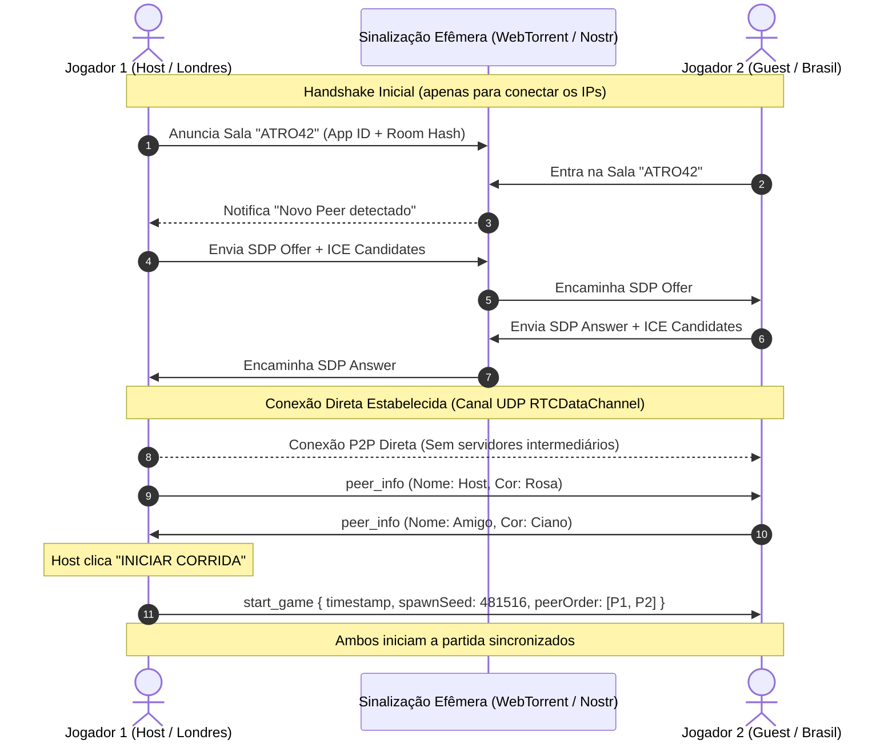
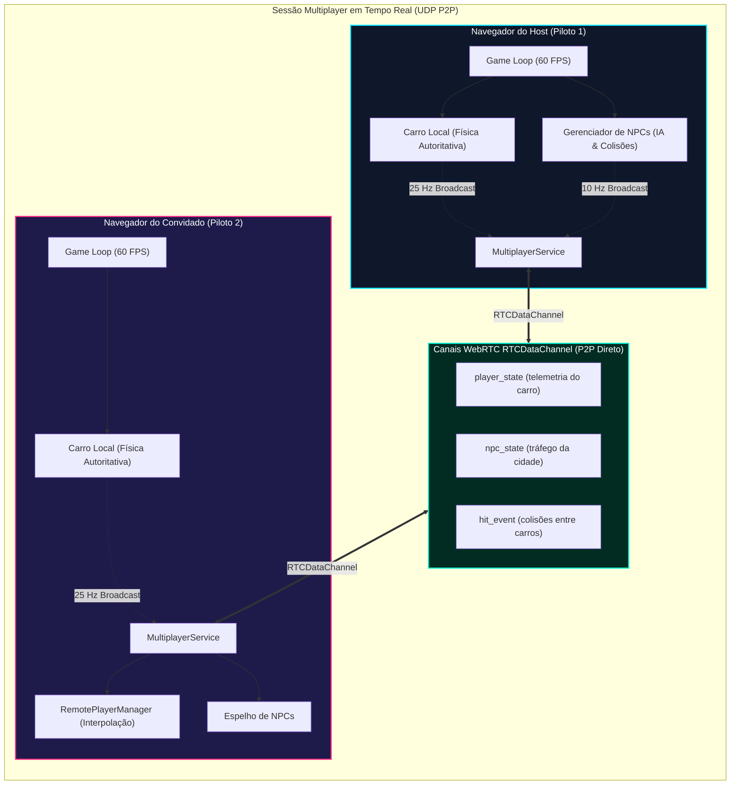
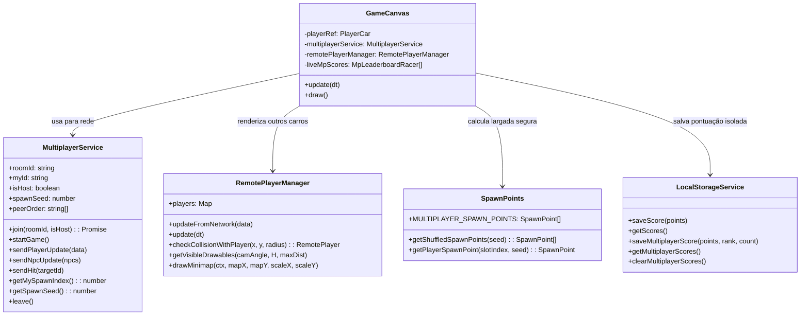

# Atropelis Simulator — Arquitetura Multiplayer P2P & Guia de Estudo

Este documento registra a investigação técnica, opções arquiteturais avaliadas, decisões de design, trade-offs e diagramas detalhados da implementação do modo multiplayer do **Atropelis Simulator**.

---

## 1. Contexto e Requisitos do Projeto

### O Jogo
* Jogo de corrida arcade retrô 2.5D (estilo *Top Gear 3000 / Mode 7* da SNES) desenvolvido em **React**, **TypeScript**, **HTML5 Canvas 2D** e som sintetizado via **Web Audio API**.
* Executado diretamente no navegador do usuário, com física veicular a 60 FPS, mapa contínuo com estradas e quarteirões urbanos, e tráfego de NPCs (pedestres, bicicletas, motos e carros).

### Restrições e Requisitos de Negócio
1. **Custo Zero de Infraestrutura (\$0/mês)**:
   * O jogo precisa ser hospedado como SPA estática no **GitHub Pages**. Não deve exigir servidores dedicados pagos (ex: instâncias VPS na AWS/DigitalOcean) para ficar online 24/7.
2. **Conectividade Transcontinental**:
   * Suporte para amigos jogando simultaneamente entre diferentes países e continentes (ex: **Londres**, **Irlanda** e **Brasil**).
3. **Simplicidade de Uso (UX de Sala)**:
   * Sem necessidade de login ou cadastro.
   * Criação e entrada rápida via código curto de sala (ex: `ATRO42`) ou link compartilhável (`https://.../?sala=ATRO42`).
4. **Isolamento de Modos**:
   * O modo multiplayer é um recurso extra: o modo solo (com física original, auto-pause ao trocar de aba e Hall da Fama independente) deve permanecer 100% preservado.
5. **Comportamento Competitivo em Tempo Real**:
   * No modo multiplayer, o jogo **não pausa** em perda de foco ou troca de abas (o tempo corre até o fim).
   * Spawns em posições separadas e aleatórias na cidade (evitando colisões acidentais na largada).
   * Placar de classificação ao vivo na tela e registro exclusivo no Hall da Fama multiplayer.

---

## 2. Opções de Arquitetura Avaliadas

Durante a fase de planejamento, três abordagens principais foram investigadas para viabilizar o multiplayer em um jogo estático:

| Critério | Opção 1: Servidor Autoritativo Dedicado (WebSocket) | Opção 2: Serverless Database Sync (Firebase / Supabase) | Opção 3: WebRTC P2P com Sinalização Serverless (Trystero) |
| :--- | :--- | :--- | :--- |
| **Custo de Infra** | Alto (\$5 – \$25/mês por servidor) | Baixo até limite gratuito; alto se exceder cotas de write/read | **Zero (\$0 - R$0)** vitalício |
| **Hospedagem no GitHub Pages** | Não (requer backend externo Node/Go/Rust) | Parcial (SPA no GH Pages, backend BaaS na nuvem) | **100% Sim** (roda puramente no cliente) |
| **Latência de Pacotes** | 80ms – 250ms (depende da região do VPS) | 150ms – 500ms (inadequado para física de carros a 25-60 FPS) | **Mínima Possível (Direct UDP)** |
| **Complexidade Operacional** | Alta (deploy, monitoramento, cold-starts, updates) | Média (regras de segurança, cotas de banco de dados) | **Baixa** (sem manutenção de servidores) |
| **Anti-Cheat / Autoridade** | Totalmente Autoritativo (servidor valida tudo) | Baixo | Cliente-Host Autoritativo (adequado para jogos casuais) |

---

### Detalhamento das Opções

#### Opção 1: Servidor WebSocket Dedicado (Node.js / Colyseus / Socket.io)
* **Como funcionaria**: Um processo Node.js rodando um loop de física em 20–30 Hz recebe as entradas dos jogadores, calcula as posições e faz broadcast do estado global.
* **Vantagens**:
  * Autoridade centralizada absoluta (impossível alterar velocidade ou pontuação via console sem rejeição do servidor).
  * Sem problemas com NAT ou firewalls simétricos.
* **Por que foi descartada**:
  * Viola o requisito de custo zero e hospedagem no GitHub Pages.
  * Se o servidor for alocado em Londres, jogadores no Brasil sofreriam ~180-220ms de ping de ida e volta obrigatório para cada comando.

#### Opção 2: Banco em Tempo Real / Serverless (Supabase / Firestore / Firebase)
* **Como funcionaria**: Os jogadores publicariam mensagens em canais realtime ou fariam writes em documentos compartilhados.
* **Por que foi descartada**:
  * Taxa de atualização (tick rate) limitada. Fazer 25 writes por segundo por jogador rapidamente estoura cotas gratuitas e gera *throttling*.
  * Overhead de serialização e protocolo HTTP/WebSocket intermediado por datacenters em nuvem, introduzindo *jitter* visual perceptível na movimentação dos carros.

#### Opção 3: WebRTC DataChannels P2P com Sinalização Efêmera (Trystero) — **A ESCOLHIDA**
* **Como funciona**:
  * **Sinalização (Handshake Inicial)**: Utiliza trackers públicos WebTorrent (BitTorrent sobre WebSockets) e relays Nostr abertos exclusivamente para trocar os metadados de conexão (oferta SDP, resposta SDP e candidatos ICE).
  * **Comunicação em Tempo Real**: Uma vez estabelecida a conexão, os navegadores abrem canais diretos **`RTCDataChannel` (UDP)** de navegador para navegador.
  * **Nenhum byte de dados da partida passa por qualquer servidor intermediário**. Os pacotes de física viajam pela rota mais curta da internet diretamente entre os PCs/celulares dos jogadores.
* **Topologia Híbrida P2P Mesh com Host-Autoridade**:
  * O criador da sala atua como **Host** para entidades neutras: simula a IA e posições dos pedestres/carros de tráfego (NPCs) e transmite aos convidados a 10 Hz.
  * Cada jogador é autoritativo sobre a sua própria telemetria de pilotagem (posição $X, Y$, ângulo, velocidade, esterçamento) e transmite a 25 Hz.

---

## 3. Diagramas de Arquitetura

### 3.1. Fluxo de Sinalização e Conexão P2P (Handshake WebRTC)

---

### 3.2. Topologia de Dados Durante a Partida

---

### 3.3. Arquitetura de Componentes e Serviços no Código

---

## 4. Problemas de Engenharia Resolvidos

### 4.1. Largada Segura: Spawns Aleatórios Sem Colisão
* **Problema**: Inicialmente, todos os carros eram instanciados no mesmo ponto fixo $(450, 850)$. Ao entrar no jogo, os carros já começavam colidindo, ativando tela tremendo (*screen shake*), sons de batida e velocidade negativa de ricochete.
* **Solução Implementada**:
  1. Mapeamento de 12 coordenadas seguras e amplas em estradas da cidade (`SpawnPoints.ts`), verificadas contra qualquer colisão (`tileMap.isColliding === false`) e alinhadas ao fluxo da via.
  2. Ao iniciar a partida, o host gera um `spawnSeed` aleatório e a lista ordenada de IDs dos participantes (`peerOrder`).
  3. Cada navegador roda o algoritmo **Fisher-Yates** com a mesma semente, gerando a mesma ordem embaralhada.
  4. O jogador no slot 0 recebe o Ponto A, o jogador no slot 1 recebe o Ponto B, garantindo centenas de metros de distância na largada.
  5. Período de graça inicial de 2,5 segundos onde colisões entre jogadores não registram penalidades ou ricochete.

### 4.2. Eliminação de Pausa no Modo Multiplayer (Background Tab Throttling)
* **Problema**: Em navegadores modernos, trocar de aba ou minimizar a janela dispara eventos `visibilitychange` e `blur`. No modo solo, pausar é desejável; no multiplayer, pausar congelaria o jogo para um jogador enquanto o outro continuaria correndo.
* **Solução Implementada**:
  1. No modo multiplayer, `pauseGame`, `resumeGame` e `handleVisibilityChange` retornam imediatamente se `multiplayerService` estiver ativo.
  2. Como o navegador desacelera `setInterval` em abas de fundo, o cronômetro de 60 segundos calcula o tempo com base no relógio real de parede:
     $$\text{tempoRestante} = \max(0, 60 - \lfloor(\text{Date.now()} - \text{startTime}) / 1000\rfloor)$$
     Dessa forma, mesmo que o jogador mude de aba por 10 segundos, ao voltar o tempo estará exatamente sincronizado com o dos adversários ("Acaba o tempo, acabou").

### 4.3. Isolamento Total de Pontuações e Placar
* **Modo Solo**: Grava em `atropelis_scores` e mantém ranking individual por data e piloto.
* **Modo Multiplayer**: Grava em `atropelis_mp_scores` salvando colocação (`#1`, `#2`), pontos e quantidade de pilotos na disputa.
* **ScoreboardView**: Interface com abas `[ MODO SOLO ]` e `[ MULTIPLAYER 🌐 ]`, impedindo mistura de pontuações de dinâmicas diferentes.
* **Desobstrução do Radar Minimap**: O placar ao vivo da sala fica posicionado no canto superior esquerdo (abaixo do banner da sala), mantendo o minimapa de radar e o cone de visão 3D no canto superior direito 100% visíveis.

---

## 5. Trade-offs da Arquitetura Escolhida

| Aspecto | O que Ganhamos (Prós) | Trade-off / Limitação (Contras) | Mitigação Adotada |
| :--- | :--- | :--- | :--- |
| **Custo de Servidor** | **Zero**. Não requer backend ou banco pago. | Depende da disponibilidade de trackers WebTorrent / Nostr para handshake inicial. | Fallback para múltiplos trackers públicos embutidos no Trystero. |
| **Latência de Jogo** | **Mínima**. Pacotes UDP viajam direto entre as máquinas. | Se o Host fechar a aba, a simulação dos pedestres/NPCs é interrompida. | O jogo local do convidado continua até o tempo esgotar; botão de saída limpa a sessão. |
| **Segurança / Trapaças** | Implementação extremamente simples e leve no cliente. | Não há servidor autoritativo para auditar memória (alguém poderia injetar score via DevTools). | Aceitável para o propósito do projeto: jogo casual entre amigos convidados por link. |
| **Topologia P2P Mesh** | Sem gargalo centralizado de banda. | Consumo de upload cresce com $O(N)$ conexões simultâneas. | Excelente para salas de 2 a 6 jogadores (cenário alvo do simulador). |

---

## 6. Referências e Arquivos no Código-Fonte

* [`src/services/MultiplayerService.ts`](file:///home/junior/git/atropelis-simulator/src/services/MultiplayerService.ts) — Gerenciamento da sala, ações P2P, sinalização e sincronização.
* [`src/components/Game/SpawnPoints.ts`](file:///home/junior/git/atropelis-simulator/src/components/Game/SpawnPoints.ts) — Algoritmo determinístico de embaralhamento e coordenadas seguras de spawn.
* [`src/components/Game/RemotePlayerManager.ts`](file:///home/junior/git/atropelis-simulator/src/components/Game/RemotePlayerManager.ts) — Interpolação de telemetria, renderização de carros remotos em perspectiva 3D e colisão.
* [`src/components/Game/GameCanvas.tsx`](file:///home/junior/git/atropelis-simulator/src/components/Game/GameCanvas.tsx) — Integração com o loop do jogo, cronômetro de parede e HUD.
* [`src/components/MultiplayerView/MultiplayerLobbyView.tsx`](file:///home/junior/git/atropelis-simulator/src/components/MultiplayerView/MultiplayerLobbyView.tsx) — Lobby visual com seleção de cores, geração de salas e link compartilhável.
* [`src/components/ScoreboardView/ScoreboardView.tsx`](file:///home/junior/git/atropelis-simulator/src/components/ScoreboardView/ScoreboardView.tsx) — Hall da Fama com separação entre Solo e Multiplayer.
